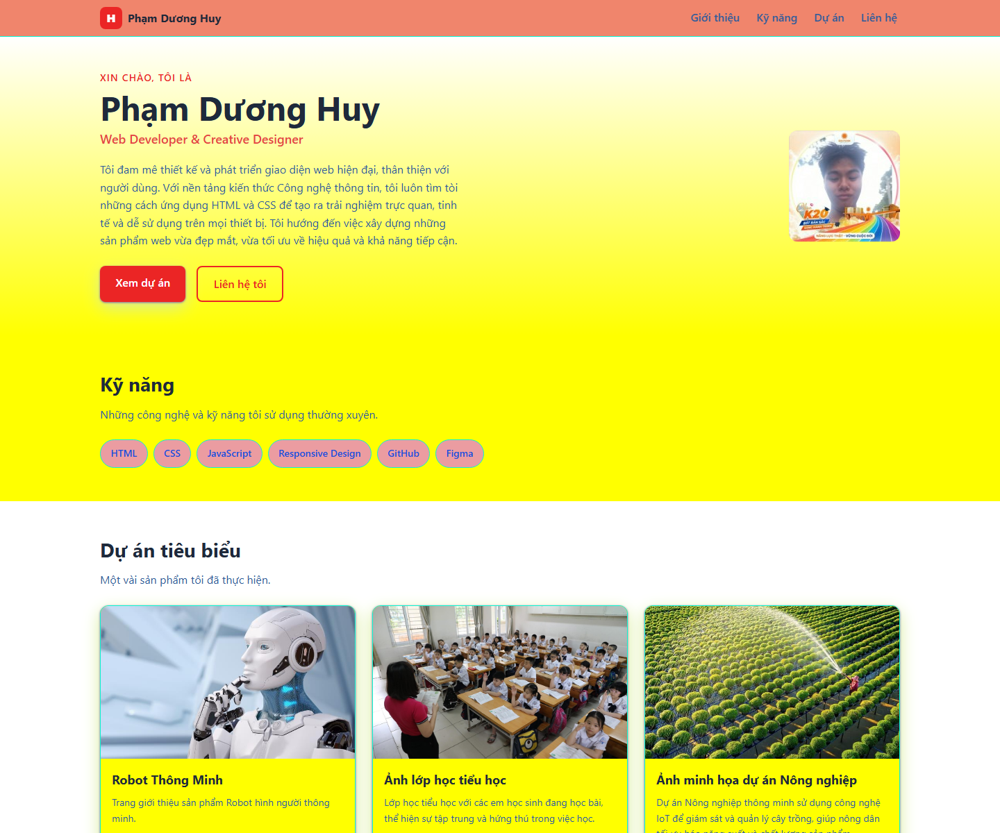
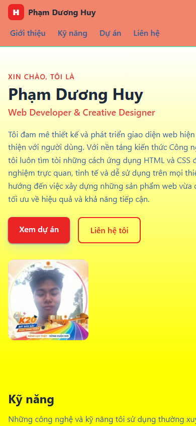

# Báo cáo kiểm thử

## Thông tin kiểm thử

- **Dự án:** Portfolio cá nhân — Phạm Dương Huy
- **Ngày kiểm thử:** 2026-10-27
- **Môi trường:** Microsoft Edge (headless), Windows; máy chủ tĩnh Python tại `http://127.0.0.1:8765/`
- **Phương pháp:** Kiểm tra thủ công trên trình duyệt, kiểm tra HTTP cho trang/tài nguyên và đối chiếu mã nguồn HTML/CSS. Dự án hiện không có bộ kiểm thử tự động.

## Tổng hợp kết quả

| Tiêu chí | Kết quả | Tóm tắt |
|---|---|---|
| Tính đúng đắn | Đạt một phần | Trang, ảnh và các đích điều hướng tải được; bốn liên kết dự án vẫn là liên kết mẫu `#`. |
| UI/UX | Đạt một phần | Giao diện desktop hiển thị; ảnh chụp mobile 390 × 844 cho thấy một số dòng chữ bị cắt ở mép phải. |
| Khả năng vận hành - xử lý lỗi | Đạt trong phạm vi kiểm tra | Máy chủ phục vụ trang và tài nguyên với HTTP 200; trang tĩnh chưa có luồng xử lý lỗi riêng. |
| Bảo mật | Đạt theo rà soát thủ công | Không thấy mã JavaScript, backend, biểu mẫu hay thư viện bên thứ ba trong trang được kiểm tra; chưa thực hiện quét bảo mật chuyên dụng. |
| Chất lượng mã nguồn | Đạt một phần | HTML ngữ nghĩa và CSS tách riêng; còn lỗi dấu ngoặc kép thừa trong thuộc tính ảnh và chưa có kiểm thử tự động. |
| Khả năng triển khai | Đạt một phần | Chạy được bằng máy chủ HTTP tĩnh ở môi trường kiểm thử; chưa triển khai production hoặc kiểm chứng Docker. |

## Kết quả chi tiết

### 1. Tính đúng đắn

- **Đạt:** Trang chính trả về HTTP 200.
- **Đạt:** Cả 8 liên kết điều hướng nội bộ đều trỏ đến phần tử có `id` tương ứng.
- **Đạt:** CSS và 5 ảnh được tham chiếu trong trang đều trả về HTTP 200.
- **Chưa đạt:** Có 4 liên kết “Xem chi tiết” sử dụng `href="#"`; các liên kết này chưa mở nội dung chi tiết của dự án.
- **Minh chứng:** [Ảnh giao diện desktop](screenshots/desktop.png).

### 2. UI/UX

- **Đạt:** Trên ảnh chụp desktop, menu, phần giới thiệu, kỹ năng và các thẻ dự án được hiển thị; ảnh đại diện và ảnh dự án tải thành công.
- **Chưa đạt hoàn toàn:** Ở ảnh chụp viewport 390 × 844, một số dòng trong phần giới thiệu và mô tả kỹ năng có dấu hiệu bị cắt ở mép phải. Cần điều chỉnh và kiểm tra lại bố cục trên màn hình nhỏ.
- **Ghi chú:** Bảng màu nền vàng sáng cùng viền/chip có độ tương phản mạnh; nên đánh giá lại khả năng đọc và tính nhất quán thị giác.
- **Minh chứng:** [Desktop 1440 × 1200](screenshots/desktop.png), [mobile 390 × 844](screenshots/mobile.png).

### 3. Khả năng vận hành - xử lý lỗi

- **Đạt trong phạm vi kiểm tra:** Máy chủ HTTP tĩnh khởi động và phục vụ trang, CSS, cùng 5 ảnh với HTTP 200.
- **Giới hạn kiểm thử:** Đây là website tĩnh, không có API, backend hoặc biểu mẫu để kiểm tra các luồng lỗi ứng dụng. Chưa kiểm thử trang 404 hay hành vi khi máy chủ/ngắt kết nối gặp lỗi.
- **Minh chứng:** [Ảnh giao diện desktop](screenshots/desktop.png); kết quả HTTP và tải tài nguyên được ghi nhận trong lần kiểm thử ngày 2026-10-27.

### 4. Bảo mật

- **Đạt theo rà soát thủ công giới hạn:** Trang HTML/CSS được kiểm tra không chứa mã JavaScript, biểu mẫu nhập liệu, thư viện bên thứ ba hoặc thông tin bí mật nhúng trong mã.
- **Giới hạn kiểm thử:** Không chạy công cụ quét lỗ hổng, không kiểm thử cấu hình máy chủ production và không đánh giá các trang/dịch vụ bên ngoài được liên kết.
- **Khuyến nghị:** Duy trì website ở dạng tĩnh nếu không cần backend; rà soát lại cấu hình máy chủ và liên kết ngoài trước khi triển khai công khai.

### 5. Chất lượng mã nguồn

- **Đạt:** HTML dùng các phần tử ngữ nghĩa như `header`, `nav`, `main`, `section` và `footer`; CSS được tách thành tệp riêng, có sử dụng Flexbox, Grid và media query.
- **Cần cải thiện:** Thẻ ảnh lớp học trong HTML có dấu ngoặc kép thừa sau đường dẫn `.jpg`. Trình duyệt vẫn tải được ảnh trong lần kiểm tra, nhưng nên sửa cú pháp để mã nguồn rõ ràng và hợp lệ hơn.
- **Cần cải thiện:** Chưa có bộ kiểm thử tự động hoặc bước kiểm tra chất lượng HTML/CSS trong dự án.

### 6. Khả năng triển khai

- **Đạt trong môi trường thử nghiệm:** Website được phục vụ thành công bằng máy chủ HTTP tĩnh Python; không cần cài dependency ứng dụng.
- **Chưa xác nhận:** Chưa thực hiện triển khai lên hosting/production và chưa chạy thử hướng dẫn Docker trong README; không xem kết quả chạy local là xác nhận triển khai production.
- **Minh chứng:** [Ảnh giao diện desktop](screenshots/desktop.png).

## Ảnh minh chứng

### Desktop — 1440 × 1200

### Mobile — 390 × 844

## Kết luận

Website hoạt động ở mức cơ bản trong môi trường máy chủ tĩnh. Trước khi đánh giá đạt toàn diện, cần hoàn thiện liên kết chi tiết dự án, xử lý hiện tượng chữ bị cắt ở viewport nhỏ và sửa dấu ngoặc kép thừa trong thẻ ảnh. Các nhận xét bảo mật và khả năng triển khai trong báo cáo chỉ giới hạn ở những gì đã rà soát và kiểm thử nêu trên.